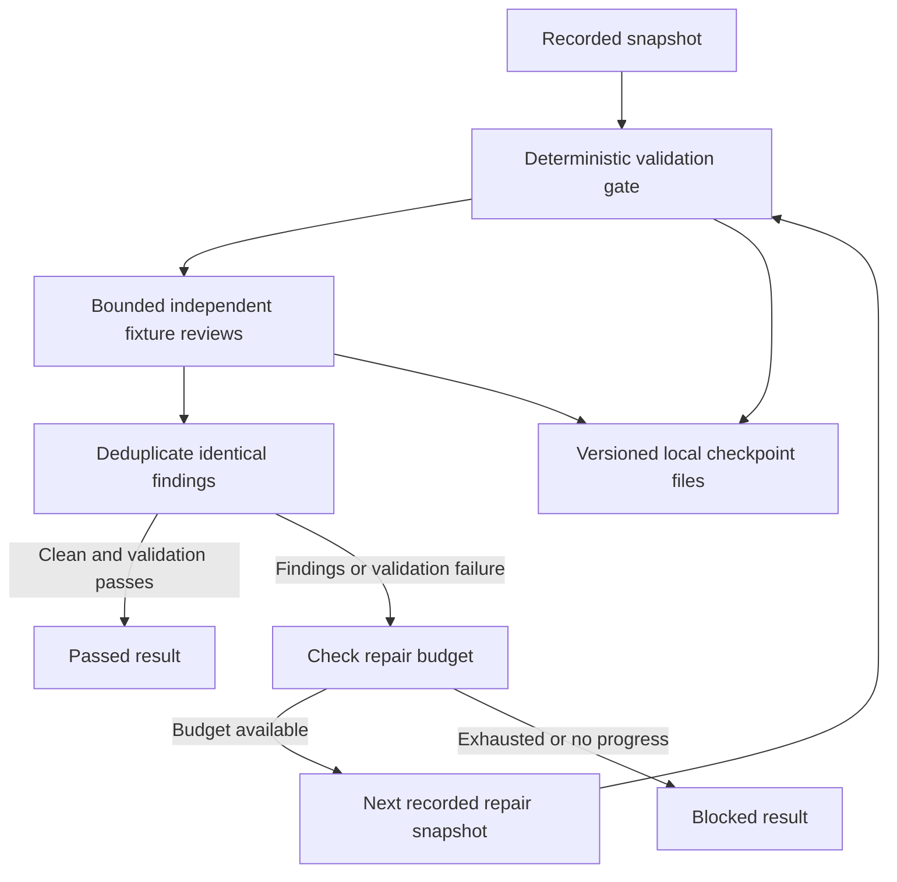

# Swamp Review Workflow

Move review coordination into deterministic code: validate a snapshot, collect independent findings, deduplicate identical concerns, apply a bounded recorded repair, validate again, and require fresh independent review before passing. The offline program uses explicit synthetic reviewer outputs and does not run an agent or edit a working tree.

Native command and resource adapters target the public [Garfield Swamp extension](https://github.com/adamhjk/garfield-extension), which implements the actual provider-backed workflow. The independent replay makes loop control and failure states inspectable without those services.

## Run

Python 3.10+; no Python packages required.

```powershell
python -B app.py demo
python -B app.py demo --output-dir artifacts/review-01
python -B app.py demo --max-actor-calls 0
python -B -m unittest discover -s tests -v
```

The first run passes after one recorded repair and six fixture reviews. The zero-repair-budget example returns a structured **blocked** result; the CLI exit status still reports whether the replay executed successfully, so consumers must inspect `status`. An output directory must be fresh and contains the fixture, one checkpoint per phase event, and a terminal result. These are this program's independent replay resources, not native Swamp resources. No target code is changed.

Repairs are limited to 0–2, review calls to 1–20 and concurrent reviewers to 1–3. A failed validation cannot pass even when reviewers find nothing. Missing verification, exhausted budgets and an unchanged repair snapshot remain blocked. Duplicate identical findings are collapsed without discarding distinct concerns.

## Native adapters

```powershell
python -B app.py native-commands --input-file examples/native-input.json
python -B app.py inspect-resource --resource path/to/unwrapped-native-result.json
```

`native-commands` prints argument arrays for upstream validation, explicit workflow execution, history and resource inspection. It executes none of them. A native run needs separately installed Swamp, the upstream `@adam/garfield` extension and an authenticated Codex CLI. Upstream native execution **edits the supplied `workspaceDir`** and may consume provider usage; review the command and input before running it yourself. The example workspace is a placeholder.

`workflow.yaml` is an independently defined Swamp workflow that references the externally installed native model method. Its required inputs follow the public contract; no implementation from that extension is copied. To validate this local descriptor, place it in the workflows directory of a configured Swamp repository and use `swamp workflow validate @example/review-resource --json`. This descriptor was not run or validated by a native CLI here.

`inspect-resource` expects the unwrapped native `result-*` JSON payload. It checks the selected identity/status/count fields, snapshot fields, timestamps and token-usage fields used by the summary. It does not claim complete validation of native plans, reviews, decisions or invocation records. Do not feed independent replay results to this adapter; they intentionally use a separate shape.

## Architecture



## Code map

| File | Responsibility |
|---|---|
| `app.py` | Typed finding parser, bounded fixture loop, concurrent fixture review decoding, local checkpoint persistence, native command/resource adapters and CLI. |
| `fixtures/review.json` | Synthetic validation, duplicate findings, recorded repair and clean verification rounds. |
| `examples/native-input.json` | Placeholder required native workflow inputs and explicit call limits. |
| `workflow.yaml` | Swamp model-method binding to an externally installed extension. |
| `tests/test_app.py` | Repair/review budgets, independent verification, no-progress blocking, malformed findings, persisted resource boundaries and native contracts. |
| `requirements.txt` | Standard-library requirement and optional native tools. |
| `.gitignore` | Generated resources, caches and local configuration exclusions. |

## Source and limits

Contracts were checked against [upstream revision `429b4a6`](https://github.com/adamhjk/garfield-extension/tree/429b4a6e6a2ac86c1bd960cf37b4759a4ee68bb3), including its README, workflow descriptor, and declared Result/Snapshot/Usage types. The [official case study](https://swamp-club.com/case-studies/code-review-token-reduction) provides context; its token/time comparisons were not reproduced.

The replay is not a substitute for model judgment, actual repairs or full native checkpoint recovery. It does not implement the extension's full risk planner, evidence adjudication, repository snapshot acquisition, agent invocation or cached-result recovery. No live Swamp/Codex process, provider call, working-tree modification, quality evaluation or performance benchmark was performed. `quality_evidence: false` is explicit in every replay result. Resource files are versioned within one local run and refuse overwrite; there is no cross-process resume claim.
